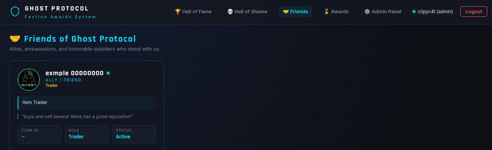
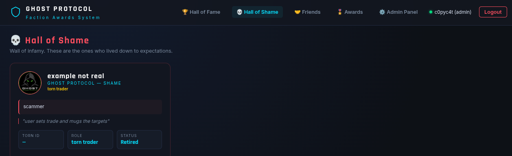
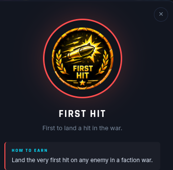
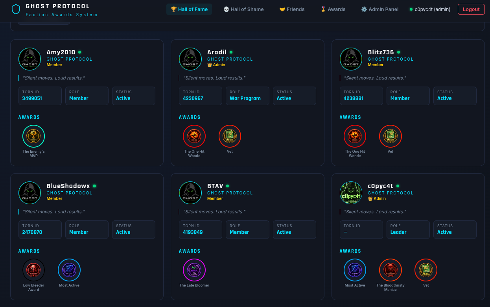
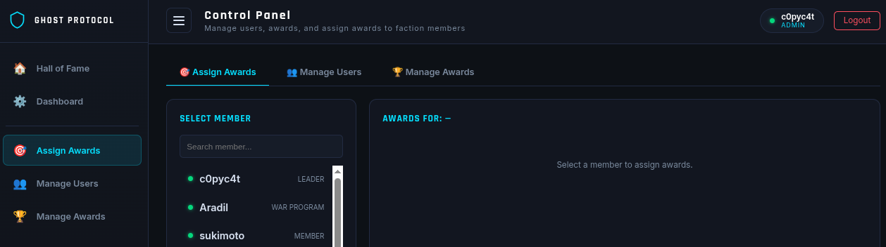
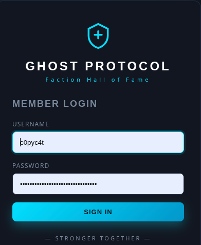

# 👻 Ghost Protocol Awards

A faction awards and recognition platform for [Torn City](https://www.torn.com/). Celebrate achievements, recognize faction members, and keep track of accomplishments with custom award icons and an easy-to-use web interface.

---

## 📸 Screenshots

Take a look around Ghost Protocol Awards.

| Friends | Hall of Shame |
|:---:|:---:|
|  |  |
| **Awards** | **Hall of Fame** |
|  |  |
| **Admin Panel** | **Login Page** |
|  |  |

---

## ✨ Features

- 🏆 **Faction Awards** — Recognize achievements and accomplishments.
- 🖼️ **Custom Award Icons** — Personalize awards with PNG images.
- 👥 **Hall of Fame & Shame** — Highlight faction members and their achievements.
- 🔐 **Admin Panel** — Manage awards through a protected interface.
- 🗄️ **SQLite Database** — Lightweight database with no separate database server required.
- 🐳 **Docker Support** — Run locally with Python or Docker Compose.
- ♻️ **Existing Database Support** — Continue using an existing database.

---

## 🚀 Installation

Choose one of the following installation methods.

### Option 1 — Run with Python

**1. Install dependencies**

Run from the project directory:

```bash
pip install -r requirements.txt
```

**2. Initialize the database**

```bash
python init_db.py
```

Follow the prompts to create your administrator account:

- Username: At least 3 characters.
- Password: At least 6 characters.
- Confirm your password when prompted.

This creates `ghost_protocol.db`, initializes the required tables, and adds the default awards.

> **Existing database?** Back it up before running initialization. Only run `init_db.py` against an existing database after confirming that the script will preserve your existing data.

**3. Start the application**

```bash
python app.py
```

Open the local address displayed in the terminal.

---

### Option 2 — Run with Docker Compose

**1. Initialize the database**

```bash
python init_db.py
```

Create your administrator account when prompted.

**2. Build and start the container**

```bash
docker compose up -d --build
```

**3. Open the application**

Visit:

**http://localhost:41321**

#### Useful Docker commands

| Action | Command |
|---|---|
| View logs | `docker compose logs -f` |
| Stop application | `docker compose down` |
| Start application | `docker compose up -d` |
| Rebuild application | `docker compose up -d --build` |

> **Database:** Make sure `ghost_protocol.db` is stored in a persistent location used by your Docker configuration. Always back it up before rebuilding or replacing application files.

---

## 🖼️ Custom Award Icons

Ghost Protocol Awards supports custom PNG icons for each award.

**Requirements**

| Setting | Requirement |
|---|---|
| Format | PNG |
| Recommended resolution | 256 × 256 px |
| Directory | `static/icons/` |

**Directory structure:**

```text
static/
└── icons/
    ├── first_hit.png
    ├── most_hits.png
    ├── last_hit.png
    ├── bleeder.png
    ├── heals.png
    ├── active.png
    ├── biggest_hit.png
    └── respect.png
```

To customize an award, simply replace its corresponding PNG file while keeping the original filename.

---

## 🔑 Default Login

Some existing installations may use the following default credentials:

```text
Username: admin
Password: password
```

<details>
<summary>⚠️ Security warning</summary>

These credentials are publicly known and should never be used on an internet-accessible deployment.

For new installations, create a unique administrator password using `init_db.py`. For existing installations, change the default password using the application's supported account-management method.

</details>

---

## 🗃️ Existing Database

You can continue using an existing `ghost_protocol.db` database.

Before updating application files:

1. Stop the running application.
2. Create a backup of `ghost_protocol.db`.
3. Keep the database in the location expected by the application or Docker configuration.
4. Restart the application.
5. Verify that existing awards and faction data are intact.

**Never replace or delete your database without a verified backup.**

---

## 🛠️ Troubleshooting

| Problem | What to check |
|---|---|
| Application won't open | Confirm the application is running. |
| Docker page unavailable | Check port `41321` and container logs. |
| Missing award icons | Verify filenames and `static/icons/` directory. |
| Login problems | Check credentials and application logs. |
| Database issues | Verify the database path and file permissions. |

To inspect Docker logs:

```bash
docker compose logs -f
```

---

## 📄 License

See the repository's `LICENSE` file if one is available. Otherwise, add a license before distributing the project.